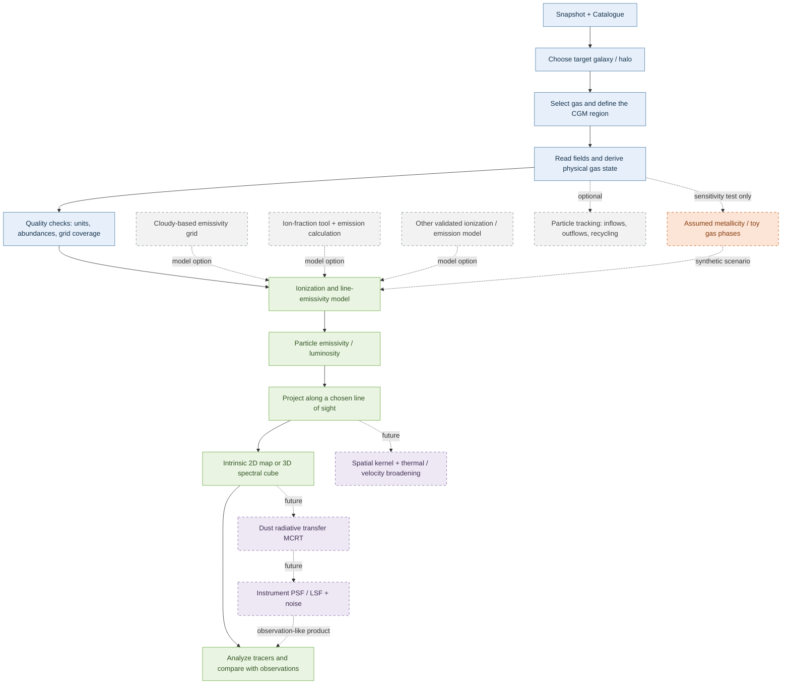

# SIMBA CGM line-emission pipeline

## Purpose

This project develops a workflow for connecting gas in the circum-galactic medium (CGM) to observable emission-line maps and data cubes. The scientific goal is to relate line emission to gas conditions and the baryon cycle, then make predictions that can be compared with observations.

## Flowchart at a glance

This is a general scientific workflow, not a map of one particular code implementation. Solid arrows show the main analysis sequence; dashed boxes and arrows indicate optional methods, sensitivity experiments, or future development.



## Configuration and running

Copy `Pipeline/config.example.yaml`, then set the input paths, target object index,
verified unit factors, line label, and map settings. Run from the repository root:

```bash
python Pipeline/scr/pipeline.py Pipeline/your_config.yaml
```

YAML supports comments beginning with `#`. Use spaces for indentation, quote
exact line labels to preserve their spaces, and write scientific notation with
a signed exponent (for example, `1.0e+10`) so it is read as a number.


The example selects a galaxy with `selection.group_type = "galaxy"` and
`selection.target_index = 0`. For a halo, set `group_type = "halo"`.
The index refers to the selected catalogue collection, not a particle ID.
Octavius is the only catalogue reader; there is no catalogue-backend switch.
Octavius must be installed in the Python environment; the HPC installation
is available in `octavius_env`.

Set `center_kpc` and `systemic_velocity_kms` to `"auto"` to read the selected
object's physical center and line-of-sight bulk velocity. Galaxies use
`com_pos_baryon` and `com_vel_baryon`; haloes use `minpot_pos` and `com_vel_total`.
Explicit numeric values override these automatic choices.

Uniform spatial bins are generated from `map_half_width_kpc` and `spatial_bins`;
velocity bins use `velocity_half_width_kms` and `velocity_bins`. For example,
a half-width of 100 kpc with 2 spatial bins gives edges `[-100, 0, 100]`.
Explicit `x_edges_kpc`, `y_edges_kpc`, or `velocity_edges_kms` arrays override
the generated edges. The line of sight remains the chosen `los_axis`.

With `periodic: true`, offsets wrap across the simulation box boundaries using
the snapshot box size and the coordinate conversion factor. An automatic
`output_filename` includes the group type, object index, and line label.

The supported input source is `simba`; the emissivity-table adapter is `ps20`.
The selection block requires `catalogue_filename`, `group_type`, and
`target_index`. Legacy selection keys are not supported.

The controller reads the catalogue's gas-row indices from the SIMBA snapshot.
ParticleIDs are included in the gas fields but are not used as selection keys.
Octavius catalogue and snapshot redshifts must agree. Matching redshift alone
does not prove row alignment: use the exact snapshot that generated the catalogue.

For PS20, zero-metallicity particles use the table's primordial slice.
Positive metallicities are clipped to the regular metallicity grid boundaries
for interpolation, with counts reported as a warning. This is an approximation;
the original gas metallicities are preserved. Temperature, density, and redshift
must remain within their table ranges.

The output is a compressed `.npz` file. Load it with:

```python
import numpy as np

with np.load("line_cube.npz") as result:
    cube = result["cube_erg_s"]
    x_edges = result["image_x_edges_kpc"]
    y_edges = result["image_y_edges_kpc"]
    velocity_edges = result["velocity_edges_kms"]
```

<!-- ## Development roadmap

Recommended additions, each with explicit validation before scientific interpretation:

1. Define the CGM aperture and ISM exclusion relative to the catalogue galaxy center and a documented halo radius.
2. Validate unit conversions, abundance columns, emissivity-table bounds, and zero-metallicity behavior with small diagnostics.
3. Add a spatial SPH-kernel projection, then thermal broadening and a well-defined spectral line profile.
4. Produce surface-brightness cubes with cosmological dimming and luminosity-distance conversion.
5. Add dust radiative transfer (for example, with SKIRT) and instrument-specific PSF, LSF, and noise models.
6. Compare mock observables across galaxy mass, redshift, line tracer, and feedback/particle-tracking selections. -->

The exploratory notebooks may test synthetic metallicity and toy multiphase assumptions before or alongside these additions. Keep those assumptions visibly separate from the native-abundance branch.

## Current code path

The controller imports `make_ppv_cube()` (from `scr/ppv_cube.py`) function, to produce data cube
in `(velocity, y, x)` order with luminosities in erg/s.
For emissivity, the controller uses `calculate_particle_line_luminosity()` (from `emissivity_tables.py`):
it asserts that the table file exists before calling the preserved dispatcher.
An unsupported table type remains a separate `ValueError`.

```
# Just schematic

scr/pipeline.py
    rows = simba.select_gas_rows(catalogue_filename, target_index, group_type)
    frame = simba.get_reference_frame(catalogue_filename, target_index, group_type)
    parameters = pipeline_input.get_cube_parameters(config, frame)
    # pipeline_input is scr/input.py; it also provides get_physical_box_size().
    gas_fields = simba.load_physical_gas_fields()

    line_lum = emissivity_tables.py

    data_cube = ppv_cube.make_ppv_cube()
```

## Pending Changes
1. Make the data cube as (x, y, $\nu$), instead of (x, y, velocity)
2. Produce a MVP of generating Cloudy emissivity tables
