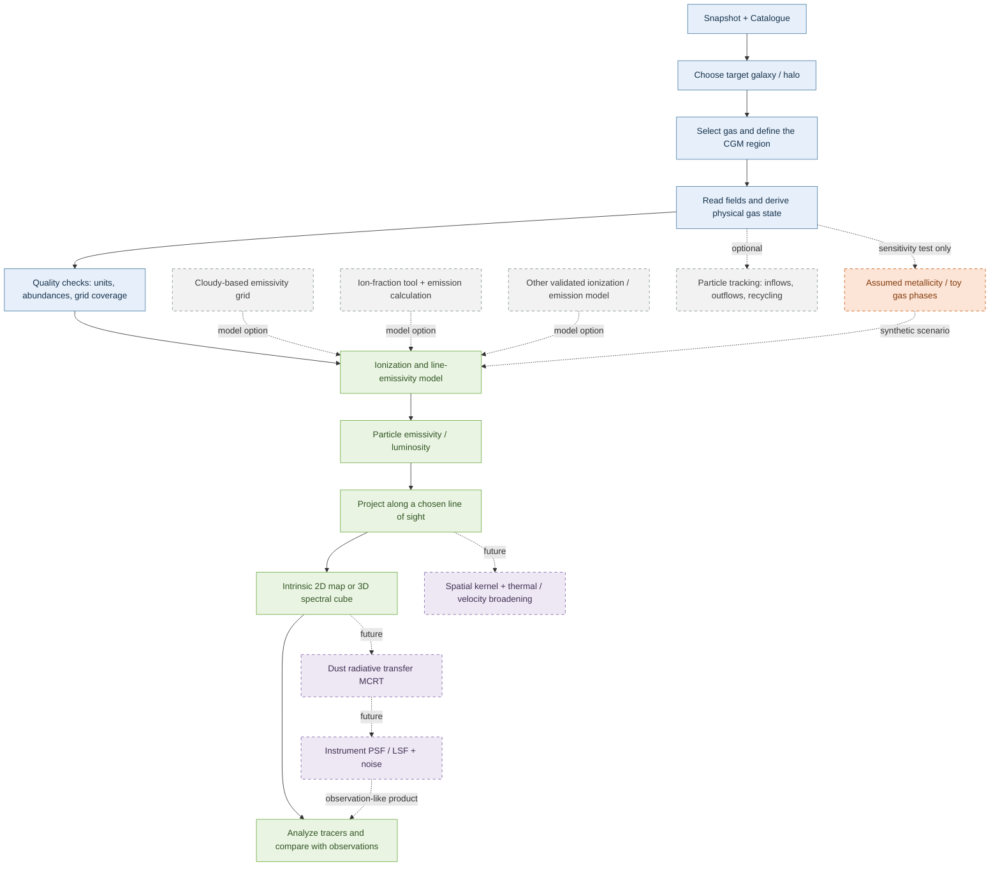

# SIMBA CGM line-emission pipeline

## Purpose

This project develops a workflow for connecting gas in the circum-galactic medium (CGM) to observable emission-line maps and data cubes. The scientific goal is to relate line emission to gas conditions and the baryon cycle, then make predictions that can be compared with observations.

## Flowchart at a glance

This is a general scientific workflow, not a map of one particular code implementation. Solid arrows show the main analysis sequence; dashed boxes and arrows indicate optional methods, sensitivity experiments, or future development.



## Configuration and running

Copy `Pipeline/config.example.json`, then set the snapshot and catalogue paths, table path, target galaxy index, verified unit factors, center, line label, bin edges, and output path. Run from the repository root:

```bash
python Pipeline/scr/pipeline.py Pipeline/your_config.json
```

The example selects a CAESAR host halo. To select only a galaxy's gas membership, set `selection.type` to `caesar_galaxy`. The supported input source is currently `simba`; the supported emissivity-table adapter is currently `ps20`.

The output is a compressed `.npz` file. Load it with:

```python
import numpy as np

with np.load("line_cube.npz") as result:
    cube = result["cube_erg_s"]
    x_edges = result["image_x_edges_kpc"]
    y_edges = result["image_y_edges_kpc"]
    velocity_edges = result["velocity_edges_kms"]
```

## Development roadmap

Recommended additions, each with explicit validation before scientific interpretation:

1. Define the CGM aperture and ISM exclusion relative to the CAESAR galaxy center and a documented halo radius.
2. Validate unit conversions, abundance columns, emissivity-table bounds, and zero-metallicity behavior with small diagnostics.
3. Add a spatial SPH-kernel projection, then thermal broadening and a well-defined spectral line profile.
4. Produce surface-brightness cubes with cosmological dimming and luminosity-distance conversion.
5. Add dust radiative transfer (for example, with SKIRT) and instrument-specific PSF, LSF, and noise models.
6. Compare mock observables across galaxy mass, redshift, line tracer, and feedback/particle-tracking selections.

The exploratory notebooks may test synthetic metallicity and toy multiphase assumptions before or alongside these additions. Keep those assumptions visibly separate from the native-abundance branch.

## Brief controller sketch (reference only)

This conceptual sketch shows some important function calling. Its indentation and calls are schematic, not executable code.

```python
main_controller():
    particle_ids = simba.select_halo_particle_ids()
    redshift = simba.get_redshift()

    emissivity = config["emissivity"]  # read from .config

    result = run_line_emission_pipeline()
        gas_fields = simba.load_physical_gas_fields()
        emission = calculate_particle_line_luminosity()
        result = make_xxv_cube()
```
