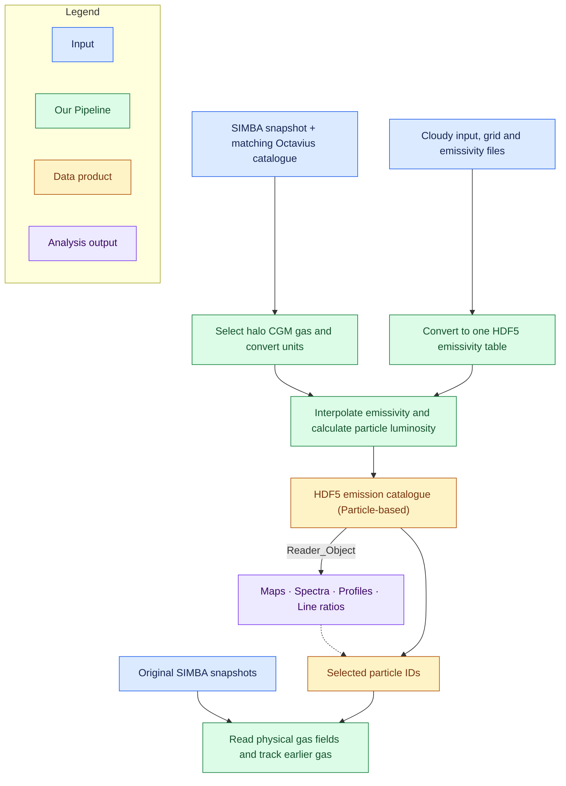

# SIMBA CGM line-emission pipeline

**One SIMBA halo · Multiple emission lines · One reusable particle catalogue**



The CGM selection uses Octavius halo membership, periodic distance from the
halo minimum-potential position, **r ≤ r₂₀₀ₘ**, and **nH ≤ 0.13 cm⁻³**.

## Prepare the Cloudy table

The pipeline includes a [Cloudy converter](scr/tables/hdf5_converter.py) that
packages the emissivity grid, axes, exact line labels, and provenance from
one completed Cloudy run into a single HDF5 file. The emission calculation
then needs only that table.

```bash
python scr/tables/hdf5_converter.py \
    --input model.in --grid model.grd --emis model.emis \
    --output cloudy_emissivity.hdf5
```

This example uses sequential model order. For a Cloudy C25 run with verified
model indices in both output files, use `--model-order cloudy-c25-index`.
You can also pass the Cloudy log with `--out model.out` to record it as
provenance.

## Run the pipeline

Use a Python environment with NumPy, SciPy, h5py, PyYAML and Octavius. Plots use Matplotlib.

1. Copy [config.example.yaml](config.example.yaml) to `config.yaml` and edit the inputs below.
2. Run from the `SIMBA-gas-emission` directory.

```bash
python scr/pipeline.py config.yaml
```

| YAML section | What to set |
| --- | --- |
| `source` | Matching SIMBA snapshot and Octavius catalogue. `redshift: auto` uses the snapshot header. |
| `selection` | `group_type: halo` and the Octavius collection index `target_index`. |
| `unit_factors` | Unit constants and gas parameters. The pipeline derives scale-factor and Hubble corrections from the snapshot. |
| `emissivity` | `type: cloudy_hdf5`, `table_filename: cloudy_emissivity.hdf5`, and a list of exact `line_labels` including internal spaces. |
| `reference_frame` | Default Reader center, bulk velocity and periodic wrapping. `auto` uses halo values. |
| `output` | A new `.hdf5` or `.h5` filename. `auto` gives `particle_emission_halo_<index>.hdf5`. |

Relative paths resolve from the YAML directory. Choose a new filename for each run.

### Submit a batch job

On a Slurm cluster, save this example as `run_pipeline.slurm`. Adjust the
memory and time for your run, and add any scheduler directives your cluster
requires, such as an account or partition.

```bash
#!/bin/bash
#SBATCH --job-name=simba-emission
#SBATCH --cpus-per-task=1
#SBATCH --mem=16G
#SBATCH --time=02:00:00
#SBATCH --output=simba-emission-%j.log

set -eu
cd "$SLURM_SUBMIT_DIR"
python scr/pipeline.py config.yaml
```

Activate the Python environment with the pipeline dependencies and submit
from the `SIMBA-gas-emission` directory.

```bash
sbatch run_pipeline.slurm
```

## Emission model and HDF5 output

For each particle and line, **L = ε m/ρ**. The pipeline stores
volume emissivity in erg s⁻¹ cm⁻³ and luminosity in erg s⁻¹.

The Cloudy adapter interpolates linear emissivity on log T, log nH and
optional log metal scale. It preserves table zeros and checks the recorded
radiation redshift. Metal grids use the table's reference metal/H ratio.
Out-of-grid coordinates are clipped and counted. **On metal grids, Z = 0
uses the lowest enriched model**, which can produce artificial metal emission.

| HDF5 group | Contents |
| --- | --- |
| `particles/` | Original snapshot rows and IDs, physical box positions, peculiar velocities, volumes and smoothing lengths |
| `lines/` | Exact labels, per-particle emissivity and luminosity, saved per-line diagnostics |
| `reference_frame/` | Default and halo centers and bulk velocities, box size and periodic flag |
| `provenance/` | Input paths, parameters, unit factors and table metadata |

Schema `codex_simba_particle_emission_v1`. Inspect line counts and clipping
where recorded with `catalogue.diagnostics[line]`.

## Read and analyse

```python
from Reader_Object import read_EmissionCatalogue

catalogue = read_EmissionCatalogue("particle_emission.hdf5")
line = catalogue.line_labels[0]
image = catalogue.make_map(line=line, field="luminosity", half_width_kpc=200, bins=128)
catalogue.plot_map(image)
```

| Task | Reader API | Notes |
| --- | --- | --- |
| Fields and metadata | `get_fields()`, `describe()` | `snapshot_row` addresses the original snapshot. `particle_id` stores the particle ID. |
| Projected maps | `make_map()` → `plot_map()` | Luminosity or observed surface brightness with Tolman dimming. Point bins by default, compact or Gaussian smoothing optional. |
| Weighted maps | `make_weighted_map()` → `plot_map()` | Temperature or LOS velocity weighted by mass or line luminosity. Temperature and mass weighting require the original snapshot. |
| Spectra | `make_spectrum()` → `plot_spectrum()` | LOS velocity bins or halo-frame Doppler wavelength bins. Thermal and instrumental broadening are outside the current model. |
| Radial profiles and ratios | `make_radial_profile()`, `make_line_ratio()`, `make_line_ratio_map()` | Plot the prepared result with `plot_profile()` or `plot_map()`. |
| Snapshot fields and tracks | `read_RawSnapshot()`, `read_RawSnapshots()` | Use `track_backward()` with complete single-file snapshots from the same run. Read aligned fields with `tracks.get_fields()`, which masks missing matches. |

[Reader notebook examples](Reader_Object/manual.md) · [Gas tracking guide](Reader_Object/tracking.md)

## Code map

| Stage | Source |
| --- | --- |
| Configuration and run | [input.py](scr/input.py) · [pipeline.py](scr/pipeline.py) |
| Selection and gas fields | [simba.py](scr/simba.py) |
| Emission and export | [emissivity_tables.py](scr/emissivity_tables.py) · [particle_output.py](scr/particle_output.py) |
| Analysis and tracking | [Reader_Object/](Reader_Object/) |
