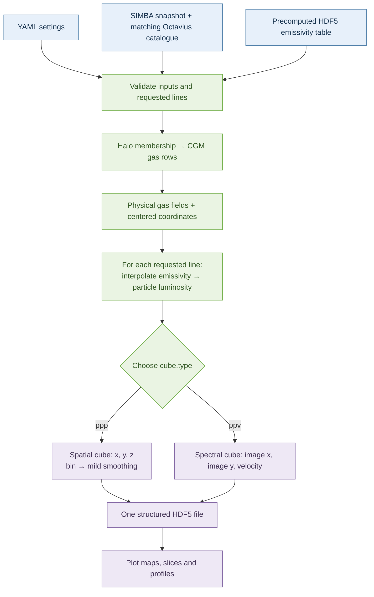

# SIMBA CGM line-emission pipeline

**SIMBA + Octavius · Multiple emission lines · PPP / PPV cubes · One HDF5 output**

Select halo gas, derive its physical state, interpolate emissivities, and map intrinsic line emission.

> **Current scope:** halo targets only; HDF5 emissivity inputs; one cube mode per run. Products are intrinsic emission predictions, not instrument-ready observations.

## Workflow at a glance



- Halo membership supplies **snapshot row indices**, not ParticleIDs.
- CGM filter: **radius ≤ r200m**, **nH ≤ 0.13 cm⁻³**; periodic distances from the halo minimum-potential position. No inner-radius or temperature cut.
- Gas conversion/centering are shared across lines. Cloudy loads once; line cubes are processed and written sequentially.

## Run

**Dependencies:** NumPy, SciPy, h5py, PyYAML and Octavius; Matplotlib for plots, Jupyter for notebooks.

1. Copy [config.example.yaml](config.example.yaml) to your own YAML file.
2. Set matching snapshot/catalogue paths, the halo index, table, requested lines and cube bins.
3. **Check the snapshot's unit convention.** YAML constants and snapshot `a`/`h` corrections are combined once.

From the `Pipeline/` directory:

```bash
python scr/pipeline.py config.yaml
```

For HPC runs, edit `run_config` and check site paths/environment/resources. From `Pipeline/`:

```bash
sbatch jobs/run_pipeline_UMHPC.slurm  # UMHPC
qsub jobs/run_pipeline_Gravity.pbs   # Gravity; choose one site
```

Job templates: [UMHPC Slurm](jobs/run_pipeline_UMHPC.slurm) · [Gravity PBS](jobs/run_pipeline_Gravity.pbs).

### Configuration guide

| YAML section | What it controls |
| --- | --- |
| `source` | SIMBA snapshot, Octavius catalogue, redshift |
| `selection` | `group_type: halo` and `target_index` — an Octavius collection index |
| `unit_factors` | Unit constants and gas-model parameters; snapshot `a`/`h` factors are derived separately |
| `emissivity` | Adapter, one HDF5 table, ordered `line_labels` list |
| `cube` | PPP/PPV mode, center, extent, bins and PPV viewing settings |
| `output` | One `.hdf5` or `.h5` filename, or `auto` |

Example sections to edit within the complete YAML:

```yaml
emissivity:
  type: cloudy_hdf5
  table_filename: /path/to/simba_cgm_T_nH_metals_hm12_z0p602.hdf5
  line_labels:                 # Exact stored identifiers, including spaces
    - 'O  8 18.9689A'
    - 'H  1 6562.81A'

cube:
  type: ppp                   # Or ppv

output:
  filename: line_cubes.hdf5    # All requested lines in this file
```

- Use a list even for one line; missing/repeated labels raise. Relative paths use **the YAML directory**.
- `redshift: auto` reads the snapshot; automatic center/bulk velocity come from the selected halo.
- `map_half_width_kpc` and `spatial_bins` generate edges; explicit edges override them. Map extent does not redefine the CGM filter.
- `cube.periodic` controls wrapping of centered cube coordinates. CGM radial selection itself uses periodic distances.
- Existing output files are **not overwritten**. Failed runs do not publish an incomplete final file.

## Scientific model

Particle luminosity follows:

$$
L_{i,\ell} = \epsilon_\ell(T_i,n_{\mathrm{H},i},\ldots)\,V_i,
\qquad V_i = \frac{m_i}{\rho_i}.
$$

Here `epsilon` is volume emissivity in **erg s⁻¹ cm⁻³**, `V` is physical particle volume in **cm³**, and `L` is luminosity in **erg s⁻¹**.

| Adapter | Table inputs | Important assumptions |
| --- | --- | --- |
| `cloudy_hdf5` | log T × log nH × optional log metal scale × line | Interpolates **linear emissivity**; fixed radiation redshift and reference element pattern. Legacy T/nH tables keep fixed composition. |
| `ps20` | Published T, nH, metallicity, redshift and line grids | PS20 log-emissivity interpolation with a dedicated primordial branch. |

**Cloudy HDF5 contract**

- Current table schema: `codex_simba_cloudy_emissivity_v2`; legacy two-axis MVP tables remain supported. Tables and datacubes have distinct schemas.
- Core datasets: `axes/log_temperature_K`, `axes/log_nH_cm3`, optional `axes/log_metal_scale`, `lines/labels`, `lines/emissivity_erg_s_cm3`; named axes, units and physics are validated.
- Linear, angle-integrated volume emissivity; exact table zeros remain zero. No emissivity floor, extra density-squared, metallicity multiplier or `4π` factor is applied.
- Metal grids use **s = (Z/X)/(Z_ref/X_ref)** from particle mass fractions and the verified GASS10 reference, not YAML `Z_sun`. Element ratios and He/H retain the table pattern.
- Out-of-grid coordinates are clipped for interpolation only. **Caveat: Z=0 uses the lowest nonzero metal scale, not primordial physics**, and can produce artificial metal emission. Warnings and saved per-axis counts expose this approximation.
- Recorded radiation redshifts must match the run. Convert `.in` + `.grd`/`.grid` + `.emis` with [hdf5_converter.py](scr/tables/hdf5_converter.py); labels and line-match caveats remain in provenance.

## Cube products

| `cube.type` | Array order | Spatial / spectral selection | Additional product |
| --- | --- | --- | --- |
| `ppp` | `(x, y, z)` | Physical x, y, z offsets | Voxel volume and volume-averaged emissivity |
| `ppv` | `(image x, image y, velocity)` | Two image axes and LOS velocity relative to systemic | Velocity edges and viewing-axis metadata |

- `cube_erg_s` contains **summed luminosity per voxel**, not flux or emissivity.
- PPP emissivity = voxel luminosity / **full voxel volume**; it is not a mean over particle emissivities.
- Summing a luminosity cube requires **no extra voxel-volume or velocity-bin-width factor**.
- Particles are first binned by position. PPP then smooths luminosity with **[1/8, 3/4, 1/8] per axis** (RMS 0.5 voxel); reflecting boundaries conserve included luminosity. Emissivity is calculated afterward. PPV retains point deposition.
- Smoothing is fixed in grid cells, with varying physical width on unequal bins. `make_ppp_cube(..., smoothing=False)` disables it for direct calls; there is currently **no YAML smoothing switch**.
- Gas outside the spatial/velocity bins remains excluded and is recorded in coverage diagnostics.
- PPV viewing/systemic-velocity settings do not apply to PPP.

### HDF5 layout

Output schema: `codex_simba_line_cubes_v2`. NPZ is not an output option.

```text
line_cubes.hdf5
├── axes/                       # Shared bin edges and units
├── geometry/
│   ├── center_kpc
│   └── voxel_volume_cm3        # PPP only
├── provenance/                 # Parameters, paths, unit stages, table axes/physics
└── lines/
    ├── labels                  # Exact labels in YAML order
    ├── line_0000/              # line_label attribute identifies the transition
    │   ├── cube_erg_s
    │   └── volume_emissivity_erg_s_cm3   # PPP only
    └── line_0001/ …
```

Per-line attributes record coverage, luminosities and applicable Cloudy clipping/zero-metal counts. Root attributes record mode, axis order, completion and PPP smoothing. These particle counts are not voxel counts or luminosity fractions.

## Plot the results

Use [Reader_Object](../Reader_Object/reader.py) from the repository root, or start with [04_Reader_mvp.ipynb](../04_Reader_mvp.ipynb):

```python
from Reader_Object import read_DataCube

datacube = read_DataCube('Pipeline/line_cubes.hdf5')
datacube.describe()
datacube.plot(lines=[0, 1])
datacube.get_statistics('luminosity', lines=0)
datacube.plot_radial_profile(lines=[0, 1], bins=20)  # PPP only
```

| Shared views | PPP views | PPV views |
| --- | --- | --- |
| `plot()`: luminosity projection | `get_fields()`: spatial slices | `get_fields()`: velocity-channel slices |
| `get_statistics()`: voxel summaries | `get_radial_profile()`: spherical shells | Saved LOS geometry and velocity edges |
| `get_diagnostics()`: saved particle/coverage counts | `plot_radial_profile()`: emission / shell / cumulative luminosity | `plot()`: velocity-summed map |

Maps show **luminosity per image pixel (erg s⁻¹)**. PPP radial mean emissivity is **ΣL/ΣV**; voxels enter shells by their centers. Empty/partial shells are flagged. Log displays mask zeros without a floor. Restart kernels after reader updates.

The older [plot_multi-line_datacubes.ipynb](notebooks/plot_multi-line_datacubes.ipynb) still expects **v1 axis order/schema**; use the reader above for current v2 output.

## Code map

| Component | Responsibility |
| --- | --- |
| [pipeline.py](scr/pipeline.py) | `main()`: prepare → select halo/CGM gas → calculate lines → save |
| [input.py](scr/input.py) | `read_parameters()`: YAML validation, defaults and paths; cube settings |
| [simba.py](scr/simba.py) | Octavius membership, CGM selection, physical-field conversion |
| [emissivity_tables.py](scr/emissivity_tables.py) + [tables/](scr/tables/) | Model dispatch, table reading and interpolation |
| [ppp_cube.py](scr/ppp_cube.py) / [ppv_cube.py](scr/ppv_cube.py) | Particle-to-voxel binning, PPP smoothing and luminosity accounting |
| [output.py](scr/output.py) | Shared HDF5 geometry, per-line products and run provenance |
| [Reader_Object/reader.py](../Reader_Object/reader.py) | On-demand fields, diagnostics, statistics, maps and PPP radial profiles |

## Limits and roadmap

PPP includes mild grid smoothing; adaptive SPH kernels, thermal broadening, dust attenuation, cosmological dimming, instrument response and noise remain future work. Metal-boundary clipping is an approximation, especially for Z=0.

Development status:

- [ ] Broader Cloudy grids, primordial models and SIMBA-compatible elemental abundances.
- [ ] Frequency/wavelength coordinates for observation-facing spectral cubes.
- [ ] Adaptive spatial kernels and thermal/velocity line broadening.
- [ ] Dust radiative transfer, including MCRT; instrument PSF/LSF and noise.
- [ ] Other validated ion-population/emission models.
- [ ] Particle tracking for inflows, outflows and recycling.
- [ ] Clearly labelled synthetic abundance/phase sensitivity experiments.
- [ ] Emission line ratios.
- [x] Datacube reader with statistics and PPP radial profiles.
- [x] Particle-to-voxel binning with mild PPP smoothing and saved provenance.
