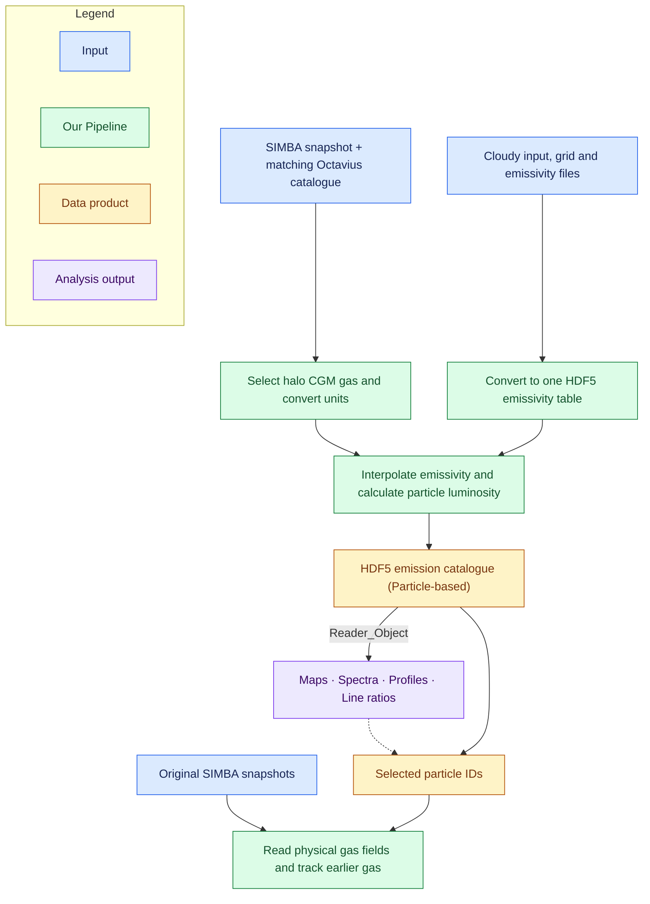

# SIMBA CGM line-emission pipeline

**One SIMBA halo · Multiple emission lines · One reusable particle catalogue**



## Documentation

- [Quickstart](docs/guide/quickstart.md) to run the pipeline for one halo.
- [Configuration reference](docs/guide/configuration.md) and [example YAML](config.example.yaml).
- [Cloudy table preparation](docs/guide/cloudy.md) and [HDF5 output format](docs/guide/output.md).
- [Analysis examples](docs/examples/analysis.md), [Reader notebook walkthrough](Reader_Object/manual.md), and [gas tracking](Reader_Object/tracking.md).
- [Current limitations](docs/guide/limitations.md) for gas selection, emissivity models, and analysis.

## Build the documentation locally

Run from the repository root with Python 3.12.

```bash
python3.12 -m venv .venv-docs
source .venv-docs/bin/activate
python -m pip install -r docs/requirements.txt
python -m sphinx -b html -W --keep-going docs docs/_build/html
```

Open `docs/_build/html/index.html` in a browser. [.readthedocs.yaml](.readthedocs.yaml) configures the same Sphinx build for Read the Docs Community.
